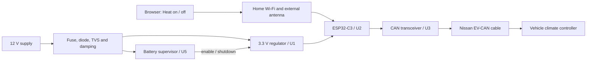

# How Leafy works

**Status on 16 November 2026:** plugged-in climate On/Off and owner-reported unplugged On have succeeded. The latest firmware displays both dashboard and BMS battery percentages received from the car. See [today’s results](WEBSITE-BATTERY-2026-11-16.md); unplugged Off and heater regression on the latest image remain to be recorded.

A browser on the home network sends an authenticated On/Off request to the ESP32-C3. The firmware sends the appropriate CAN sequence through the specified Nissan cable. The car must be within usable 2.4 GHz Wi-Fi range.

| Block | Role |
| --- | --- |
| U1 / L1 | Convert vehicle power to 3.3 V; exposed-pad regulator and 22 µH inductor |
| F1 / D1 / D3 / C15 / R21 | Fuse, reverse blocking, transient clamp and input damping; real transient performance remains untested |
| U2 | ESP32-C3-WROOM-02U-N4, Wi-Fi MCU with external antenna socket |
| U3 | TCAN3404DRQ1 CAN transceiver, fixed to EV-CAN; no selectable second bus or extra board termination |
| U5 | Independent low-battery cutoff, even if firmware hangs |
| U6 | Disconnects the live battery divider from the unpowered processor ADC |
| U4 / J3 | Protected 3.3 V serial programming; no on-board USB socket or power input |

Nominal cutoff/restart is about **11.67/12.68 V at VPWR after the diode**, with delays and tolerances in the design review. These are calculations, not measured battery-terminal thresholds. The antenna's 300 mm lead permits mounting outside the enclosure, on plastic inside the car; improved range is not yet measured.

The tested board cut off at approximately **11.66 V** and restarted at **12.25 V**, both measured at TP3/VPWR. These are single-board observations, not guaranteed limits. Its calibrated firmware uses ADC correction 0.9820 and an owner-selected 11.9 V software heat threshold; the public template retains 12.2 V. Neither threshold represents traction-battery charge percentage.

The page requires a separate control key and uses ordinary HTTP on a trusted LAN. Save key for this tab validates and stores the key in session storage; Forget removes it. HTTP 202 means a request was accepted into the queue, not that heating was confirmed. There is no cloud service, mDNS or OTA update implementation. Reserve the board's IP address in the router; do not use port forwarding. Router guest/client isolation can prevent access.

Reconnect retries are unlimited with a 30-second cap. Reboot/reconnect does not replay old On requests. While idle, CAN listens without transmitting for 1.5 seconds each minute, then returns to standby. It does not wake the car for battery readings. The sequencer supports Off preemption, bounded transmit waits and a local 15-minute Off timer. A CAN acknowledgement is not proof that climate started. Loss of board power or bus communication can prevent Off; check the car's own timeout.

This prototype does not provide cellular access, diagnostics, charging control, door locking, temperature setting or support for every Leaf generation. No automotive, EMC, ingress or environmental qualification is claimed.

## Battery display

The normal page shows dashboard SOC first and BMS SOC second, with independent sample ages. Different percentages are expected because these are different vehicle signals; neither is battery health. A sleeping bus may stop providing data. After 120 seconds the page labels a value as last known/stale; after reset it waits for a sample instead of displaying zero. The automatic Off-request countdown reflects the existing 15-minute timer and does not confirm that the car has stopped heating.

## Optional iOS API bridge

A local Node.js server connects the [native iOS app](../ios/README.md) to Leafy. It authenticates app requests, forwards explicit On/Off commands without automatic retries, and returns voltage plus age-labelled BMS SOC when supported by the installed firmware. It runs on a computer that remains awake on home Wi-Fi. The native app has been built and tested in the iPhone simulator against a fake car. Both percentages are already live on the normal website, which needs no external server. The bridge still exposes BMS SOC only; physical iPhone and end-to-end vehicle testing through it remain outstanding. See [server setup](../server/README.md).
